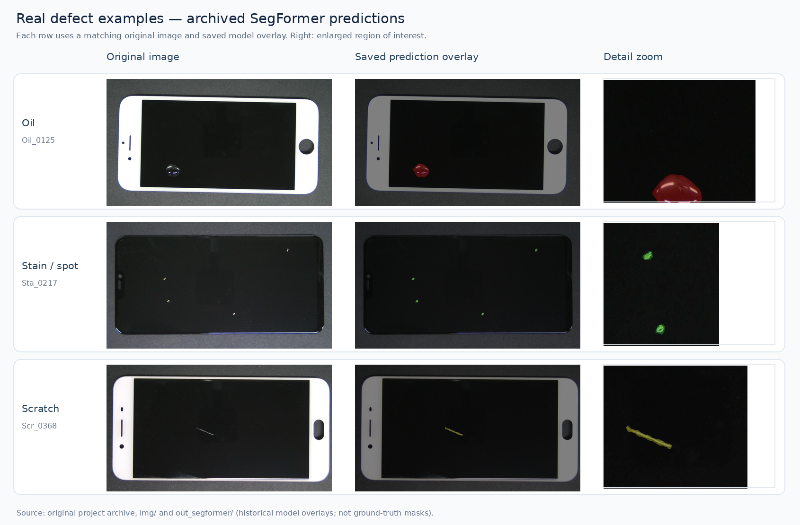
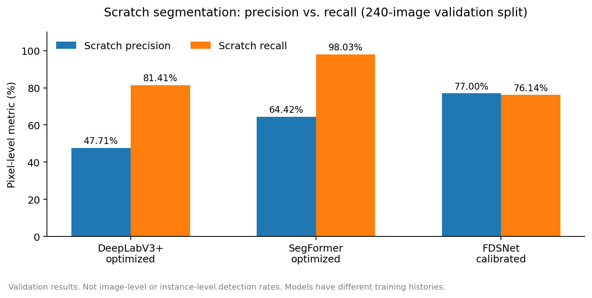
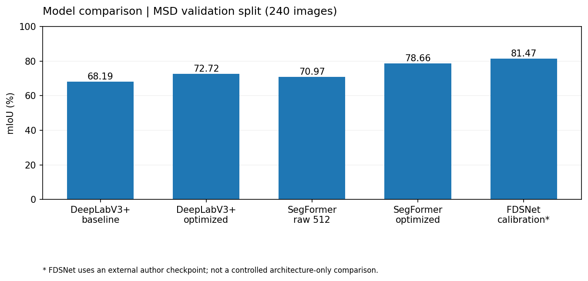
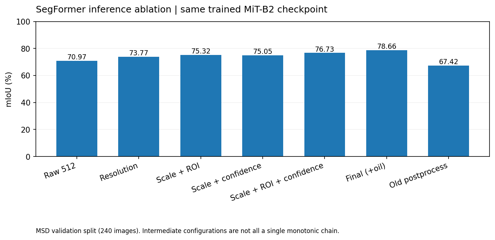
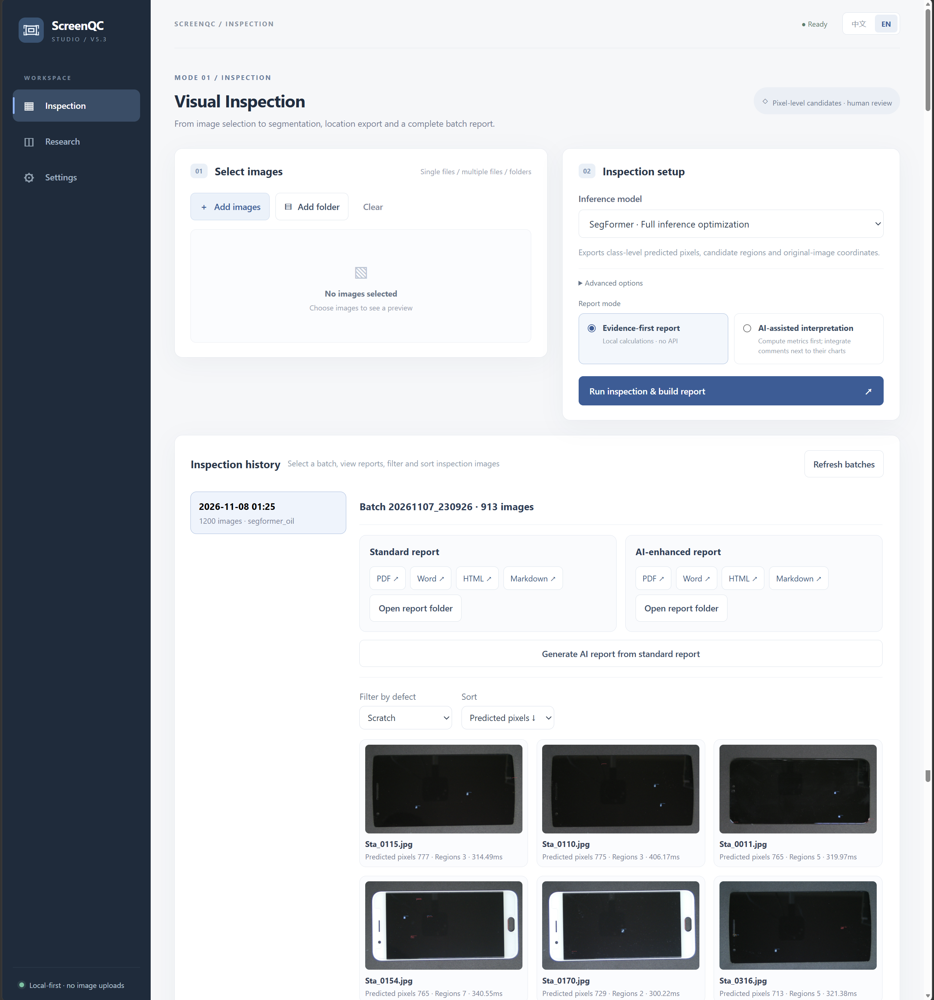

# ScreenQC Studio

**Research-driven pixel-level screen defect segmentation and visual inspection**

ScreenQC Studio detects **oil marks, spot/stain defects and scratches** in mobile-phone screen images. It combines a research pipeline for comparing segmentation models and controlled inference strategies with a local inspection application for batch review and evidence-based reporting.

**Workflow:** `Images → preprocessing → segmentation → defect masks/regions → evaluation or batch review → reports`

The work has two research tracks: **(1) attention and loss optimization in DeepLabV3+**, and **(2) imbalance-aware SegFormer training and controlled inference optimization**, including approaches that were tested and rejected. The focus is not simply the highest mIoU: **fine scratches and small defects make the false-negative/false-positive trade-off important**.



## Research contributions

### 1. DeepLabV3+: training improvements and controlled baselines

- **Baseline:** MobileNetV2-backed DeepLabV3+; four-class label handling, image/label preprocessing and reconstruction to original-image coordinates.
- **Training:** explored **Convolutional Block Attention Module (CBAM)**, class-weighted **Focal Loss**, and **Dice-based segmentation supervision** through four configurations: baseline, loss-only, attention-only, and combined. Main baseline/combined results use **different trained checkpoints**.
- **Inference:** retained geometric reconstruction and explored optional morphological/component filtering; this postprocessing was **not enabled** for the final DeepLab benchmark, so it is not credited with the gain.

**Validation mIoU: 68.19% → 72.72% (+4.53 percentage points)** for baseline vs. the combined trained configuration. This is a measured **combined** improvement, not a separately quantified benefit for each training change.

### 2. SegFormer MiT-B2: training, failure analysis and inference decisions

- **Imbalanced training:** implemented a composite **Dice + Focal + Lovász-Softmax + Boundary** objective, **online hard-example mining (OHEM)**, Copy-Paste augmentation and defect-biased cropping. Early aggressive sampling/loss settings were revised to include more difficult background and reduce false-positive pressure. Individual training components **have not all been independently ablated**.
- **A key negative result:** earlier sliding-window inference, Gaussian blending and multi-scale test-time augmentation produced many false positives and diverged from the training-time resize evaluation. The final comparison uses **resize-aligned inference**, not a claim that more elaborate TTA always helps.
- **Same-checkpoint inference study:** compared input scale, estimated screen **region of interest (ROI)**, class-dependent confidence decisions and an oil-specific threshold. Also evaluated discarded morphology/area filters to expose category-level trade-offs. All of these inference comparisons reuse **one final MiT-B2 checkpoint**.

**Validation mIoU: 70.97% → 78.66% (+7.69 pp)** with unchanged weights. The final oil-decision step accounts for **76.73% → 78.66% (+1.93 pp)**; oil precision rose **74.66% → 83.94%**, while oil recall decreased **94.27% → 93.17%**. Aggressive historical morphology/area filtering reduced overall mIoU to **67.42%**, despite helping some class-specific scores.

### 3. Why prioritize recall?

For inspection assisted by a human reviewer, missing a subtle scratch may be more costly than flagging an additional region for review. Our optimized SegFormer therefore offers a **high-recall operating point**, not an unconditional win across every metric:

- **Macro pixel recall:** **95.22%** (optimized SegFormer) vs. **87.43%** (FDSNet calibration candidate).
- **Scratch pixel recall:** **98.03%** vs. **76.14%**, respectively.
- **Trade-off:** FDSNet scores higher on overall mIoU (**81.47% vs. 78.66%**), precision and evaluated pipeline speed. Higher recall may increase manual-review workload.

These are **pixel-level** metrics, *not* percentages of scratches or phones successfully detected. The appropriate threshold depends on the relative cost of misses and false alarms, and no production-line error-rate claim is made.



## Results

**MSD local validation split: 240 images; mIoU includes background and the three defect classes.**

| Evaluated configuration | mIoU ↑ | Precision ↑ | Recall ↑ | F1 ↑ |
|---|---:|---:|---:|---:|
| DeepLabV3+ baseline | 68.19% | 73.86% | 84.90% | 78.22% |
| DeepLabV3+ optimized training | 72.72% | 77.32% | 89.07% | 82.00% |
| SegFormer MiT-B2, raw inference | 70.97% | 72.31% | 97.20% | 81.57% |
| **SegFormer, optimized inference** | **78.66%** | **81.73%** | **95.22%** | **87.45%** |
| FDSNet, exploratory calibration | 81.47% | 90.82% | 87.43% | 89.06% |



**SegFormer same-weight ablation:** 70.97% raw → 73.77% scale-only → 75.32% scale+ROI / 75.05% scale+confidence → 76.73% combined rules → **78.66% final**. These are comparisons of configurations, not a full factorial attribution of each component.



**Evaluation scope:** the local 240-image `val` split was reused during parameter exploration; it is not an untouched test set. DeepLab models use separate checkpoints, SegFormer inference variants share one checkpoint, and FDSNet uses an authors' pretrained checkpoint that may overlap the local evaluation images. Cross-model results compare available *pipelines*, not architecture-only effects.

### Visual examples

The figure shows **matched oil, spot/stain and scratch examples**, with original MSD images and archived SegFormer overlays. These are illustrative **historical predictions**, not ground truth or a representation of the final tuned checkpoint.


## System capabilities

- **Inspection:** single images, folders and batches; semantic masks, per-class pixel counts, connected regions, original-image coordinates, sorting, filtering and history.
- **Research:** model checkpoints and inference variants, aggregate confusion matrices, per-class IoU/precision/recall/F1, controlled ablations and visualization export.
- **Reporting:** deterministic PDF, editable Word, HTML and Markdown reports. Optional **LLM-assisted analysis** interprets a structured evidence package; it does not calculate or replace measured metrics.
- **Local-first:** Python/PyTorch backend, browser UI (HTML/CSS/JavaScript), bilingual controls and optional API integration.


**Research workspace**  


**Inspection workspace**  


**Settings**


## Architecture & quick start

```text
Local web UI → Python task service → model adapters (DeepLabV3+ / SegFormer / FDSNet)
                                  ├── batch predictions → masks, coordinates, inspection history
                                  └── evaluation → metrics, class errors, ablations
                                  → structured evidence → standard reports → optional LLM interpretation
```

**Stack:** Python · PyTorch · OpenCV · NumPy · Matplotlib · ReportLab · python-docx · JavaScript.

**Windows / Python with PyTorch installed** (CUDA GPU recommended):

```powershell
python -m pip install -r requirements.txt
python main.py doctor
python main.py gui
```

Or use `00_START_GUI.cmd`. Weights and the MSD dataset are supplied separately; configure their paths locally. `01_MIGRATE_ALL.cmd` can copy prior local weights and report history without deleting the originals.

**Code layout:** `research/` training and earlier experiments · `model_adapters/` inference · `evaluation/` metrics · `industrial/` batch inspections · `paper/` reporting and LLM · `app/` UI · `tests/` regression checks.

A concise explanation of the development decisions is available in [Research notes](assets/doc/research-notes.md).


## Sources & acknowledgments

- [MSD dataset](https://github.com/jianzhang96/MSD) (authors also provide separate defect-free `good.zip` samples)
- [SegFormer paper](https://arxiv.org/abs/2105.15203) · [official code](https://github.com/NVlabs/SegFormer)
- [DeepLabV3+ paper](https://arxiv.org/abs/1802.02611)
- [FDSNet paper](https://doi.org/10.1109/ICASSP43922.2022.9747311) · [authors' code](https://github.com/jianzhang96/fdsnet)

**Developed by Dong.** Third-party model and dataset terms apply; please review licenses and original implementations before redistribution. The inspection workflow provides candidate regions for review, not certified manufacturing acceptance decisions.
